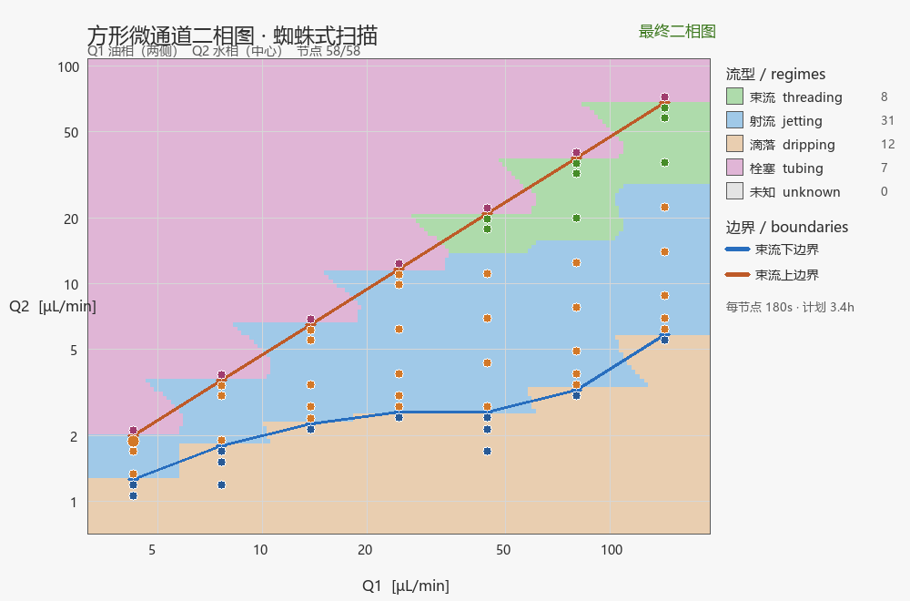

# mcs-date

面向微流控芯片的**两相流实验系统**：实时视频液滴识别、注射泵连接控制、以及"蜘蛛式"分节点扫描自动测绘**二相图**（流型图）并输出缓慢成图的动画。

本仓库从 [MCS_QT](https://github.com/snow78408-del/MCS_QT) 移植了视觉分析与泵通信的核心代码（原工程未做任何修改），并新增了实验扫描、二相图建模与动画层。所有功能都可以在没有相机、没有串口、没有显示器的机器上以**离线仿真**方式跑通。



## 三部分系统

| 部分 | 模块 | 作用 |
| --- | --- | --- |
| ① 视觉 | `mcs_date.vision` | 实时视频采集/读帧 → 管道区域定位 → 液滴检测、跟踪、尺寸与流量统计 |
| ② 泵 | `mcs_date.pump` | TS 注射泵 1200/8/E/1 串口协议；真实串口后端 + 仿真后端；流量设定、回读校验、安全停机 |
| ③ 实验 | `mcs_date.experiment` | 蜘蛛式节点扫描 → 流型分类 → 上下边界夹逼 → JSON/CSV 结果 → 二相图动画 |

```
src/mcs_date/
├── vision/        # 移植自 MCS_QT backend/vision（裁剪版）
│   ├── pipeline.py        VisionPipeline：帧 → VisionResult
│   ├── detector.py        液滴检测（胶囊轮廓/插头几何）
│   ├── channel_region.py  管壁定位与校正
│   ├── tracker.py / kalman_tracker.py / nearest_tracker.py
│   ├── metrics.py / bead_counter.py
│   └── cameras/models.py  相机数据模型（真实 SDK 适配器未移植）
├── pump/          # 移植自 MCS_QT backend/pump_hardware（裁剪版）
│   ├── protocol.py        WSS/RSS/WSP/RSP/WSE/RSE 帧编解码
│   ├── client.py          PumpClient（pyserial 可选）
│   ├── service.py         PumpBackend 抽象 / SimulatedPumpBackend / SerialPumpBackend / PumpController
│   └── invariants.py      Q1 >= 2*Q2 安全约束
├── experiment/
│   ├── phase.py           FlowRegime、NodeFeatures、RegimeThresholds、classify_regime
│   ├── chip.py            ChipSimulator：由流量点生成流型与带噪测量特征
│   ├── models.py          ScanConfig / NodeRecord / BoundaryBracket / ScanResult
│   ├── strategy.py        SpiderScanner：从稳定工作点向两侧扩展 + 二分夹逼边界
│   ├── runner.py          ExperimentRunner（真实时钟/虚拟时钟）、run_offline_scan
│   ├── report.py          JSON/CSV 持久化（schema_version=1）
│   └── animate.py         OpenCV 渲染 + 纯 Python GIF89a 编码器
├── demo.py        三部分离线演示（合成视频、仿真泵、离线扫描 + 动画）
└── __main__.py    CLI：demo / scan / animate / vision / pump
```

## 快速开始

```bash
git clone https://github.com/snow78408-del/mcs-date.git
cd mcs-date
python -m venv .venv
.venv\Scripts\activate          # Windows
pip install -e ".[dev]"

# 一次跑通三部分（离线，无需硬件）
python -m mcs_date demo --out out
```

如果暂时不想安装（或没有网络装 setuptools），也可以直接用源码目录运行：

```powershell
$env:PYTHONPATH = "src"     # Windows PowerShell
# export PYTHONPATH=src     # Linux/macOS
python -m mcs_date demo --out out
```

`demo` 会依次输出：

- `out/demo_vision.png`：合成微通道视频上的液滴检测标注（三帧拼图）；
- 泵设定 (80, 20) µL/min 的回读值、故意违反 `Q1 >= 2*Q2` 时的安全报错、停泵回读；
- `out/scan_result.json`、`out/nodes.csv`、`out/phase_diagram.gif`、`out/phase_diagram_final.png`。

## 命令行

```text
python -m mcs_date demo    --out out [--quiet]
python -m mcs_date scan    --out out [--center-q1 80] [--center-q2 20] [--node-seconds 180] [--no-animate]
python -m mcs_date animate --result out/scan_result.json --out out
python -m mcs_date vision  --synthetic [--max-frames 120] [--out out]
python -m mcs_date vision  --video input.mp4   [--wall-top 0.30 --wall-bottom 0.70]
python -m mcs_date vision  --camera 0
python -m mcs_date pump    [--q1 80] [--q2 20] [--port COM3]
```

不带参数时打印帮助并返回 0。

## ① 视觉：液滴识别

`VisionPipeline.process_frame(frame, timestamp=..., current_wall_lines=[...])` 接收一帧 BGR 图像并返回 `VisionResult`（`detections` / `tracking` / `beads` / `metrics` / `channel_region` 等）。

- `current_wall_lines` 传入两条归一化管壁直线（`{"x1","y1","x2","y2"}`，坐标 ∈ [0,1]）时，直接按手动管壁做 ROI 校正，跳过自动标定；不传则走 `ChannelRegionDetector` 自动定位。
- 管道区域未定位（`status` 为 `collecting`/`rejected`）时返回空检测结果。
- `detections.centers`、`detections.radii` 可直接用于画圈与计数；尺寸/插头长度等字段在标定后才有意义。

CLI 的 `--synthetic` 使用内置合成视频（亮通道 + 深色液滴，与 MCS_QT 采集视频极性一致）验证整条链路。真实相机路径用 OpenCV `VideoCapture`；MCS_QT 的海康/GenTL/大恒等厂商 SDK 适配器没有移植，需要时可在 `vision/cameras/` 下按 `FramePacket` 约定接入。

## ② 泵：连接与控制

- 协议：TS 注射泵 1200/8/E/1，串口 `1200 8E1`，地址 1..31；帧格式 `FLAG(0xE9) + 转义(addr,len,pdu,fcs)`，`fcs` 为 XOR 校验。支持 `WSS/RSS`（使能与回读）、`WSP/RSP`（流量参数与回读）、`WSE/RSE`（运行状态）。
- 通道约定：**CH1 = 连续相（油）总流量 Q1**，**CH2 = 分散相（水）流量 Q2**。
- 安全约束：`Q1 >= 2 * Q2`（可用 `STRICT_Q1_Q2_GAP_UL_MIN=0.2`、`STRICT_Q1_Q2_RATIO=2.0` 调整），由 `PumpController.apply()` 在写泵前强制校验。
- `SimulatedPumpBackend`：无硬件时完整模拟设定/回读/停泵，用于测试与演示。
- `SerialPumpBackend`：真实串口后端（需 `pip install -e ".[hardware]"` 安装 pyserial），包含注册通道、写参数、逐通道回读校验、启动与停泵确认。

```python
from mcs_date.pump import PumpController, SimulatedPumpBackend

pump = PumpController(SimulatedPumpBackend())
pump.connect()
print(pump.apply(80.0, 20.0))   # -> (80.0, 20.0)
pump.stop()
pump.close()
```

## ③ 实验：蜘蛛式扫描与二相图

### 扫描策略

`SpiderScanner` 从**已知稳定工作点**（默认 Q1=80、Q2=20 µL/min）出发：

1. 以 `station_step_ratio=1.8` 沿 Q1 向左右交替扩展出多个"蜘蛛腿"站位（默认最多 7 个），保持 Q1/Q2 中心比例不变；
2. 每个站位固定 Q1，沿 Q2 以 `step_ratio=1.6` 乘法步幅向低、向高两个方向逐点测量；
3. 每个节点：换流量 → 稳定等待 `startup_s=30 s` → 观测 `node_duration_s=180 s`（约 3 分钟/节点）；
4. 首次出现流型变化时记录边界区间，再用几何二分（默认 3 轮）夹逼边界位置；
5. 遇到单侧极限（低流量已滴落、高流量已栓塞）或达到节点预算即收手。

默认完整扫描约 **58 个节点、17 个边界、约 3.4 小时**（离线仿真用虚拟时钟，秒级跑完）。

### 流型与边界

`FlowRegime`：`dripping`（滴落）、`jetting`（射流）、`threading`（稳定束流）、`tubing`（栓塞/充满）、`displacement`（浸润/指进）、`unknown`。

流型分类由 `classify_regime(NodeFeatures)` 依据观测窗口内的连续液流覆盖率、液滴生成频率、液滴直径与变异系数等特征判定，阈值集中在 `RegimeThresholds`，可用真实数据标定。

边界类型（`BoundaryBracket.kind`）：

- `stream_onset`：滴落 ↔ 连续液流之间，**下边界**；
- `flood_onset`：连续液流 ↔ 栓塞之间，**上边界**；
- `thread_onset`：射流 ↔ 稳定束流之间（辅助信息）。

在二相图上，下边界与上边界之间即"连续束流"存在的流量窗口；动画里两条折线随节点逐点出现，最终形成完整的流型分区。

### 结果文件

`scan_result.json`（schema_version=1）包含配置、中心节点、全部节点、边界区间与阈值；`nodes.csv` 每个节点一行，便于用 Excel/pandas 复核。`load_result()` 可回读后重新生成动画。

### 动画

`animate_scan(result, out_dir)` 生成：

- `phase_diagram.gif`：每测一个节点画一帧，流型区域按已测节点做最近邻填充，边界逐条出现，最后定格在完整二相图（可循环播放）；
- `phase_diagram_final.png`：最终静态图。

渲染只依赖 OpenCV（numpy），GIF 由内置纯 Python GIF89a 编码器写出，不需要 matplotlib/Pillow/ffmpeg。若环境里恰好装有 Pillow，会额外用系统中文字体（如 `msyh.ttc`）渲染中文标签；没有 Pillow 时自动回退为英文标签，不影响成图与动画生成。

## 与文献的关系（流型判据）

边界模型参考 Cubaud & Mason, *Capillary threads and viscous droplets in square microchannels*, Phys. Fluids 20, 053302 (2008)：

- 方形截面十字通道中，以两相毛细数 `Ca_i = μ_i J_i / σ`（表观速度 `J_i = Q_i/h²`）划分流型；
- 稳定束流直径近似 `δ/h ≈ √(Q1/(2Q2))`（本芯片角色互换后为 `√(Q2/(2Q1))`）；
- 文献中 `Ca1 ≈ 0.1` 附近是滴落 ↔ 射流/稳定束流的转折，高 `Ca`、高鞘相流量趋向稳定束流，过高则进入栓塞；低 `Ca` 会出现浸润/指进。

**注意角色映射**：文献的 L1 是更粘的中心相、L2 是鞘相；本芯片 CH1（油）是两侧鞘相、CH2（水）是中心相。因此 `ChipSimulator` 里的边界参数（`ChipModelConfig`）是按本芯片几何/流体角色重写的**待标定参数**，不是文献常数的直接套用。真实标定方法：用已知流型的实验点拟合 `lambda_low / lambda_up / ca_thread_min` 等参数，再替换 `ChipModelConfig`。

## 安全与真实硬件

- 所有硬件写操作都有超时、回读校验与异常传播；扫描结束（含异常）一定停泵。
- 真实相机/串口都通过同一套抽象接入，测试与 CI 不需要硬件。
- 像素标定（`pixel_to_micron`、通道宽度）缺失时，视觉只适合预览；不要用未标定的尺寸做定量结论。
- 仿真器的流型阈值只是"可跑通"的工程近似，**不能替代真实实验标定**。

## 开发

```bash
pip install -e ".[dev]"
pytest            # 48 个测试，全部离线
ruff check .
```

测试覆盖：流型分类、芯片模型边界单调性、扫描边界夹逼与时间预算、JSON/CSV 往返、GIF 编码往返（自写解码器校验）、视觉合成帧检测、泵仿真与安全约束、CLI 各子命令。

## 许可证

[MIT](LICENSE)

## 致谢

视觉与泵通信核心代码来自 [MCS_QT](https://github.com/snow78408-del/MCS_QT)（本仓库仅复制裁剪，未修改原工程）。
